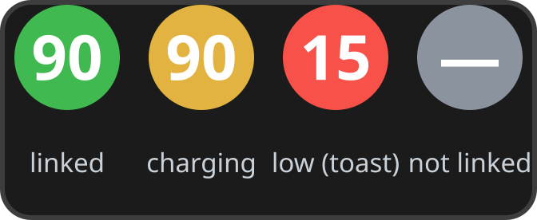

# tb-tray

Battery indicator for the **Turtle Beach Stealth 700 Gen 3** in the Linux
system tray. Companion to
[tb-heal](https://github.com/richard523/tb-heal): it polls `tb-heal --json`
on a timer and turns the answer into a tray icon, a status menu and a
low-battery toast.



## The icon

The battery percent is drawn **into** the icon itself - no icon theme
needed, the SVGs are generated on the fly into `~/.cache/tb-tray/` and
reused after that.

| Color | Meaning |
|---|---|
| green circle, e.g. `90` | linked, battery fine |
| amber circle, e.g. `90` | charging |
| red circle, e.g. `15` | linked and <=20% - also fires one desktop toast |
| gray circle with dash | not linked / transmitter missing / tooling problem |

Two deliberate choices:

- Gray, not a number, when unlinked: the dongle still returns the
  last-known battery when the headset is off, and a stale number must
  never read as live.
- The low-battery toast fires **once** when the battery crosses 20%,
  rearmed only at >=25% or on charge - a battery hovering at 20% cannot
  spam notifications.

Where the shell supports tray labels, `90%` is set as a text label next
to the icon as well. The full status line is always in the tooltip and
the first menu entry, e.g.
`My Headset: linked, battery 90% (charging) [13:41]`.

## Menu

| Item | Effect |
|---|---|
| status line | live status (state, battery, last update time) |
| Refresh now | poll immediately |
| Copy status | `wl-copy` the status line |
| Run tb-heal | one-shot tb-heal, report shown as a notification |
| Quit | exit (autostart brings it back next login) |

## GNOME

Vanilla GNOME Shell **ships no system tray** - without a tray host,
tb-tray (and any AppIndicator) simply will not appear. On GNOME you
need the **AppIndicator and KStatusNotifierItem Support** extension:

- Arch: `pacman -S gnome-shell-extension-appindicator`, then enable it
  in Extensions or `gnome-extensions enable appindicatorsupport@rgcjonas.gmail.com`
- Fedora: `dnf install gnome-shell-extension-appindicator`
- Debian/Ubuntu: `apt install gnome-shell-extension-appindicator`

tb-tray speaks StatusNotifierItem over D-Bus like every other
AppIndicator, so it also works unmodified on KDE Plasma, MATE,
Cinnamon, XFCE and Budgie, and it is happy on Wayland sessions. It
pairs fine with dash-to-panel - the icon lands in the panel like any
other tray item.

## Requirements

- [tb-heal](https://github.com/richard523/tb-heal) on `PATH`
  (`~/.local/bin/tb-heal`) - it does the actual USB work
- `libayatana-appindicator`, `python-gobject`
- `wl-clipboard` (Copy status), `libnotify` (toasts)
- a tray host - see the GNOME section above

## Install

```sh
./install.sh            # ~/.local/bin/tb-tray + autostart entry
~/.local/bin/tb-tray &  # start now without relogging
```

The autostart entry (`~/.config/autostart/tb-tray.desktop`) starts it
at every login. `./uninstall.sh` removes both the binary and the
autostart entry.

## Usage

| Option | Meaning |
|---|---|
| `--interval S` | poll interval, default 120 s (min 10) |
| `--heal` | also re-run tb-heal's self-heal each poll (default: report only - a healing daemon would fight deliberate output switching) |
| `--version` | print version |

Polling is report-only by default and single-instance guarded; a second
launch prints a note and exits.

## How it reads the battery

Each poll runs `tb-heal --json --no-heal` (~0.4 s, the Airoha RACE
exchange against the transmitter - read-only) in a worker thread, so
the tray never blocks. A poll that comes back with a transient error
(USB claim lost to a concurrent query - tb-heal serializes its own
exchanges on a lock, so this is rare) is retried once before the error
reaches the icon.

The 120 s default is deliberate. Every poll briefly detaches the
dongle's HID driver - a kernel usbfs requirement: control transfers
need an interface claim, and the claim needs the driver off (verified
EBUSY otherwise, even for EP0). During that ~0.4 s window the
headset's physical volume/mic controls are blind. Slow cadence plus
tb-heal's trimmed exchange keeps the blind window at ~0.3% duty, so
rolling the volume wheel during an update is essentially never hit.
If you also run tb-heal manually or accept a longer blind window,
`--interval 300` is a reasonable belt-and-braces setting.

## License

MIT - see [LICENSE](LICENSE).
